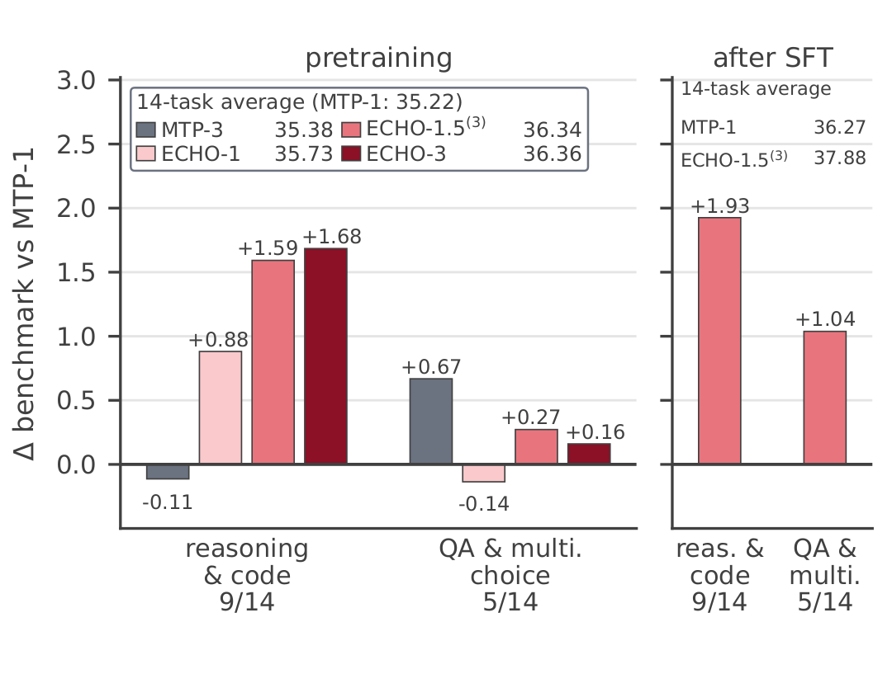
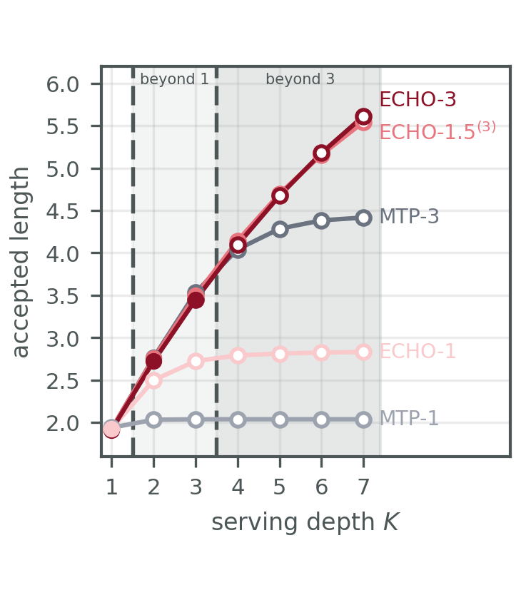

# ECHO: Efficient Causal Self-Recursion Beyond Auxiliary Multi-Token Prediction

[](https://github.com/ernie-research/ECHO/releases)

This repository contains the artefacts for the ECHO paper. ECHO is a multi-token prediction design that
reuses the backbone's last layer as the body of every MTP depth, and samples how
many depths to train at each optimizer step (depth `D ~ pi` over 1, 2, 3 with
probabilities 0.6, 0.3, 0.1, so `E[D] = 1.5`). Both comparisons against
DeepSeek-MTP are cost-matched: ECHO-1 is compared with MTP-1 at equal depth-one
cost, and ECHO-1.5 with MTP-3 at half the MTP cost.

| | |
|---|---|
|  |  |

Left: benchmark gain by task class over the fourteen reported benchmarks, each
stage against the DeepSeek baseline of its own stage — ECHO-1.5 matches ECHO-3's
gain at half its MTP overhead. Right: accepted length against serving depth `K`,
filled inside the trained depth and hollow beyond it — ECHO keeps gaining where
auxiliary MTP saturates. This is Figure 1 of the paper; `figure_plot/` holds the
scripts, inputs and outputs behind both panels.

## The headline numbers

Unweighted mean over the fourteen reported benchmarks. Pretrained, step 78k, no
EMA:

| ECHO-1 | ECHO-3 | ECHO-1.5(3) | MTP-1 | MTP-3 | ECHO-2(7) |
|---|---|---|---|---|---|
| 35.73 | 36.36 | 36.34 | 35.22 | 35.38 | 35.57 |

After one round of supervised finetuning:

| MTP-Instruct | ECHO-1.5(3)-Instruct | ECHO-2(7)-Instruct |
|---|---|---|
| 36.27 | 37.88 | 38.37 |

The SFT checkpoints were trained on a small instruction-following dataset
whose purpose is to give the models instruction-following behaviour, not to
optimise benchmark scores. The SFT rows above are reported for completeness;
they are not instruction-tuning benchmark results.

In the first table, the two cost-matched pairings to compare are ECHO-1 against
MTP-1 and ECHO-1.5(3) against MTP-3. Per-benchmark values are in
`benchmark_table/`, together with which of the fourteen rows this repository
re-derives and which it does not.

## Checkpoints

Three of the pretrained models and the three finetuned ones are on the
[releases page](https://github.com/ernie-research/ECHO/releases), one release
per model:

| model | release | stage | MTP depths stored | size | downloads |
|---|---|---|---|---|---|
| MTP-1 | [`ckpt-mtp-1`](https://github.com/ernie-research/ECHO/releases/tag/ckpt-mtp-1) | pretrained, step 78k | 1 | 22.0 GB | [](https://github.com/ernie-research/ECHO/releases/tag/ckpt-mtp-1) |
| ECHO-1 | [`ckpt-echo-1`](https://github.com/ernie-research/ECHO/releases/tag/ckpt-echo-1) | pretrained, step 78k | 1 | 22.0 GB | [](https://github.com/ernie-research/ECHO/releases/tag/ckpt-echo-1) |
| ECHO-1.5(3) | [`ckpt-echo-1.5`](https://github.com/ernie-research/ECHO/releases/tag/ckpt-echo-1.5) | pretrained, step 78k | 3 | 23.7 GB | [](https://github.com/ernie-research/ECHO/releases/tag/ckpt-echo-1.5) |
| MTP-1-Instruct | [`ckpt-mtp-1-instruct`](https://github.com/ernie-research/ECHO/releases/tag/ckpt-mtp-1-instruct) | SFT, step 5000 | 1 | 22.0 GB | [](https://github.com/ernie-research/ECHO/releases/tag/ckpt-mtp-1-instruct) |
| ECHO-1.5(3)-Instruct | [`ckpt-echo-1.5-instruct`](https://github.com/ernie-research/ECHO/releases/tag/ckpt-echo-1.5-instruct) | SFT, step 5000 | 3 | 23.7 GB | [](https://github.com/ernie-research/ECHO/releases/tag/ckpt-echo-1.5-instruct) |
| ECHO-2(7)-Instruct | [`ckpt-echo-2-7-instruct`](https://github.com/ernie-research/ECHO/releases/tag/ckpt-echo-2-7-instruct) | SFT, step 4800 | 7 | 27.1 GB | [](https://github.com/ernie-research/ECHO/releases/tag/ckpt-echo-2-7-instruct) |

Each is the checkpoint behind its column in the tables above (MTP-1-Instruct is
the MTP-Instruct column). A release is one model directory: `config.json`, the
safetensors index and shards byte for byte as evaluated (bf16, router biases
fp32), and the tokenizer. GitHub lists a sha256 digest for every file. The
weights are released under this repository's MIT license.

The tokenizer loads with `AutoTokenizer.from_pretrained` on the release
directory. The evaluation starts every prompt with id 2 (`<|ERNIE_MASK|>`),
which `encode` does not add; `eval_stochastic_hf.py` prepends it. The instruct
tokenizers carry the SFT chat template, so
`apply_chat_template(messages, add_generation_prompt=True)` gives the same ids
as the script's `--chat-format target_chatv2`, and their generation config also
stops on `<|im_end|>` (id 8).

Only `config.json` was edited. It declares the public class names
(`model_type: echo_target`, `TargetForCausalLM`; see
`paddle_hf_alignment/README.md`), and MTP-1's `mtp_reuse_last_layer` is now
`false`: its export said `true`, but MTP-1's depth layer is its own, not a copy
of layer 23. The loader below builds every depth from its own weights whatever
the flag says, as it did for the paper's measurements, so no output changes.
Only `preserve_mtp_sharing=True` reads the flag; with the old value it would
have run MTP-1's draft through layer 23, and now it raises an error.

```bash
gh release download ckpt-echo-1.5 -R ernie-research/ECHO -D ckpts/echo-1.5
```

```python
import sys, torch
sys.path.insert(0, "paddle_hf_alignment/src")
from modeling.torch_weight_loader import build_and_load_torch

model, config, stats = build_and_load_torch("ckpts/echo-1.5", device="cuda", dtype=torch.bfloat16)
```

Use this loader, not `AutoModel.from_pretrained`. The shards keep the export's
key names (per-expert `w1`/`w2`/`w3`, MTP depth d as `model.layers.{23+d}`),
which match 243 of the model's 14,298 state-dict keys, so the generic loader
would leave almost every weight at its initial value. `build_and_load_torch`
maps the keys, takes the number of MTP depths from the weights rather than the
config, and loads every depth from its own keys.

### Extrapolation needs each depth's router bias

Every MoE router has an `e_score_correction_bias`, the auxiliary-loss-free
balancing term that is added to the sigmoid scores before the top-8 choice.
Training adjusts it from expert usage instead of by gradient, so it is a buffer,
not a Parameter, and ECHO's parameter sharing does not cover it. In the ECHO
checkpoints each MTP depth's layer is bit-identical to layer 23 except for this
one tensor: every depth has a bias of its own. In our preliminary experiments,
sharing one bias across all depths slightly increased the loss.

Extrapolation depends on these biases being loaded correctly. Past the trained
depth D, every further draft step applies depth D's module again, bias included
(`mtp_heads[-1]` in `eval_stochastic_hf.py`), so whatever that module carries is
repeated at each extra step. The checkpoint has no `model.layers.{23+d}` for
d > D; a loader that looks one up has to fall back to depth D rather than run a
layer with nothing loaded into it.

Load depth d's bias from
`model.layers.{23+d}.block_sparse_moe.e_score_correction_bias` and keep it in
fp32. Each of the following sends the draft's tokens to other experts than the
ones it was trained with:

- running layer 23 as the MTP layer because the weights are shared, which uses
  layer 23's bias;
- running the first depth's module at every depth of a multi-depth checkpoint;
- skipping the MTP layer's keys because its weights are shared, which leaves the
  bias at its zero initialisation;
- casting the loaded model with `.to(torch.bfloat16)`, which casts float buffers
  as well (the loader casts first and restores the bias to fp32 afterwards).

`build_and_load_torch` loads every depth's bias from its own key in fp32.

### Checking extrapolation

`paddle_hf_alignment/eval/eval_stochastic_hf.py` decodes with a checkpoint's
own MTP heads at any draft depth `--K` and reports the acceptance rate at each
depth (`per_step_accept`) and the accepted length. The rates behind Figure 1b
come from this script at `--K 6 --max-new 256`, greedy, pooled over GSM8K,
MATH500 and HumanEval in the SpecBench prompt format
(`paddle_hf_alignment/data/specbench/`): the first 50 prompts of each set for
ECHO-1.5(3), the first 500 for ECHO-1 and MTP-1 (HumanEval has 164).

| | trained depths | depth 1 | 2 | 3 | 4 | 5 | 6 | accepted length, K=6 |
|---|---|---|---|---|---|---|---|---|
| ECHO-1.5(3) | 1–3 | 0.927 | 0.905 | 0.896 | 0.882 | 0.861 | 0.837 | 5.23 |
| ECHO-1 | 1 | 0.926 | 0.618 | 0.393 | 0.300 | 0.330 | 0.527 | 2.82 |
| MTP-1 | 1 | 0.938 | 0.100 | 0.059 | 0.049 | 0.000 | – | 2.04 |

The rate at depth k counts only the rounds in which depths 1 to k-1 were
accepted, so the deep entries rest on few rounds: MTP-1 reaches depth 4 in 658
of 118,691 rounds and depth 6 in none, ECHO-1 reaches depth 6 in 1,941 of
87,379. These runs predate the loader's fp32 handling of the router bias:
every layer's bias, target and draft alike, was rounded to bf16, so the current
code will not reproduce the digits exactly.

```bash
cd paddle_hf_alignment && mkdir -p results
ln -s ../ckpts/echo-1.5 tokenizer      # the script reads the tokenizer from ./tokenizer
for s in gsm8k math500 humaneval; do   # --n 500 for ECHO-1 and MTP-1
  python eval/eval_stochastic_hf.py --ckpt ../ckpts/echo-1.5 --gpu 0 \
    --dataset data/specbench/${s}_conv.jsonl --n 50 --max-new 256 --K 6 --temp 1e-6 \
    --skip-target --out results/echo-1.5_${s}_K6.json
done
```

`--temp 1e-6` is greedy (argmax). Add `--chat-format target_chatv2` for the
instruct checkpoints.

## Contents

| | |
|---|---|
| the grading chain | the extraction and aggregation code as it ran, with the per-item records it ran on |
| model code | an HF/PyTorch implementation checked against the Paddle original, runnable both ways on the same prompts |
| drafter training | the draft models, the trainer entry, the launch configs, and the corpus pipeline |
| serving measurements | the raw run records behind the reported accepted lengths |

Six checkpoints and their tokenizer are release assets (see
[Checkpoints](#checkpoints)); no corpus is included. `accept_length` in a
`results.jsonl` row is a mean over that run's samples, not a per-request record.

Cluster paths, hostnames, job identifiers and internal package wheels have been
replaced; `<WORKSPACE>`, `<HOST>`, `<HOST_IP>` and `<JOB_ID>` stand where they
appeared. In shell scripts the first is written `${WORKSPACE:?set WORKSPACE}`, so
a script parses as it stands and says what to set. No number was touched.

## Grading

A score on these benchmarks depends on how the generations are graded as much as
on the model. A cell in the paper is the unweighted mean over sub-tasks of the
per-item mean; the plain per-item mean over the same generations gives:

| benchmark | per-item mean | mean over sub-tasks | difference |
|---|---|---|---|
| MMLU, ECHO-1 | 53.72 | 55.93 | +2.21 |
| MMLU, MTP-1 | 54.78 | 56.39 | +1.61 |
| MMLU-Pro, ECHO-1 | 24.89 | 26.02 | +1.13 |
| MMLU-Pro, MTP-1 | 25.32 | 26.60 | +1.28 |

The gap the paper reports between ECHO-1 and MTP-1 over the fourteen benchmarks
is 0.52 points, so on MMLU the aggregation convention alone is worth four times
the effect. Answer extraction and the few-shot prefix behave the same way: in
`benchmark_table/cot_effect/`, the same 216 BBH items answered directly rather
than with chain-of-thought move ECHO-1.5's lead over MTP-1 from +3.24 to +8.33.

`benchmark_table/results/` holds the per-item records that were graded and
`benchmark_table/scoring/` the extraction and aggregation code as it ran, so a
score measured elsewhere can be put on the same footing.

```bash
cd benchmark_table && python3 score.py        # 18 of 18 rule-graded cells match
```

Two further cells are graded by executing the generated programs
(`scoring/code_score.py`, `scoring/lcb_score.py`). Five rows carry the
evaluation platform's own number instead — MATH, MBPP+, PreciseWikiQA, HotpotQA
and PopQA — and that chain's answer extraction and judging rules are not
published, so these rows cannot be reproduced exactly outside that chain. Our own runs of
them cannot be put next to the paper's cell either: a different few-shot prefix,
an answer-extraction rule that does not match for MATH, a weaker test bar for
MBPP+, and for the three closed-book sets a 600-item sample rather than the full
set, judged by a different chain. BBEH keeps no retained verdicts, so it is not
re-derivable here either. None of them is offered as a second measurement.
`benchmark_table/README.md` gives the detail.

## Layout

**The benchmark table** — `benchmark_table/` (`tab:benchmark_results`,
`tab:train-twice`, `tab:sft`). Per-item records for ECHO-1, MTP-1 and ECHO-1.5,
the grading code as it ran, and `score.py`, which recomputes each cell from the
records with nothing read from a summary. `cot_effect/` is the same BBH items
decoded with and without chain-of-thought. Its README says which of the fourteen
benchmarks have records here and why six do not.

**Drafter training** — `draft_training/`. The ECHO-side files of the training
stack: the draft model definitions (DSpark 2.22B, EAGLE-3 0.67B, DFlash 2.12B),
the trainer entry, and the launch configurations, including the twelve-node
launcher that trained three drafters side by side at a common global batch of 48.
This is what plugs into SpecForge; the framework itself is upstream.
`data_collection/` is the corpus pipeline: the target regenerates assistant
turns on open-perfectblend prompts, those are tokenised and packed into the h5
the trainer reads. The code and the validation rules are here; the generated
corpus is not, since it is the target's own output.

**Model code alignment** — `paddle_hf_alignment/`. The checkpoints are
Paddle-trained and exported in HF format, so the HF/PyTorch modelling code has
to reproduce the Paddle one. Both implementations are here with a harness that
runs the same fifty GSM8K prompts through each, so the agreement can be
re-measured rather than taken on trust.

**Engine alignment** — `hf_sglang_alignment/`. Training reads the target through
an sglang engine instead of an HF eager copy; this is the record of making the
two agree numerically, plus the code that exports a trained draft into an
sglang-servable one.

**Figures** — `figure_plot/`. The Figure 1 to 8 scripts, all required
plotting inputs, and generated PDF/PNG outputs are organised into `scripts/`,
`inputs/`, and `outputs/`. The accepted-length serving diagnostics are under
`figure_plot/archive/` with their scripts and inputs.

**Serving measurements** — `figure_plot/archive/serving/` keeps the two
accepted-length diagnostics behind the serving discussion with the per-run
records they reduce, so both regenerate: the target-temperature ×
draft-temperature grid and the same-temperature diagonal. Everything there is
the paper's serving stack, one node of eight H800 GPUs, at concurrency 1. Decode
speedup is reported in the paper and not re-derived here.
`benchmark_results/entropy/` contains the target's predictive entropy per task,
including the retained per-sequence records.

**Environment** — `env_20260929/`. Pip freezes and system information for the
environments the measurements were taken in.

## Decode speedup

Accepted length is a property of the logits and the acceptance rule, so it may
be read across panels and hardware. Decode speedup may not: it depends on how
far the serving kernels have been optimised. The sglang path here was taken only
as far as training needed — enough kernel work to make the target forward cheap
and to make it agree with the HF reference — so speedup measured on it is a
lower bound on the method. The paper's speedup numbers come from a different
serving stack, which is not included.

## Citation

The paper is currently under review; a citation will be added here once it is
publicly available.
