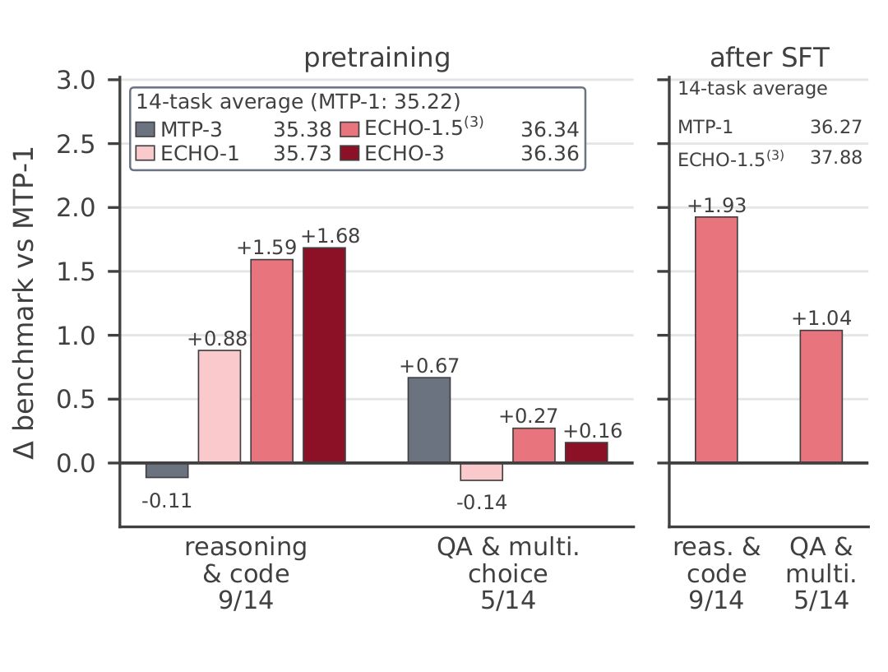
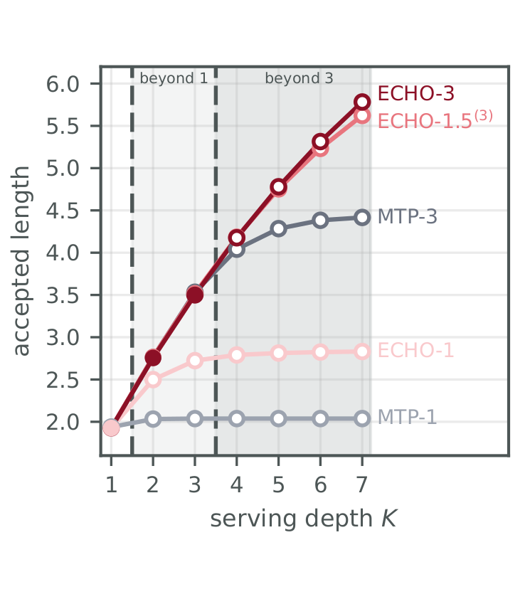

# ECHO: Efficient Causal Self-Recursion Beyond Auxiliary Multi-Token Prediction

Artefacts for the ECHO paper. ECHO is a multi-token prediction design that
reuses the backbone's last layer as the body of every MTP depth, and samples how
many depths to train at each optimizer step (depth `D ~ pi` over 1, 2, 3 with
probabilities 0.6, 0.3, 0.1, so `E[D] = 1.5`). Both comparisons against
DeepSeek-MTP are cost-matched: ECHO-1 against MTP-1 at equal depth-one cost,
ECHO-1.5 against MTP-3 at half the MTP cost.

| | |
|---|---|
|  |  |

Left: benchmark gain by task class over the fourteen reported benchmarks, each
stage against the DeepSeek baseline of its own stage — ECHO-1.5 matches ECHO-3's
gain at half its MTP overhead. Right: accepted length against serving depth `K`,
filled inside the trained depth and hollow beyond it — ECHO keeps gaining where
auxiliary MTP saturates. This is Figure 1 of the paper; `figure_plot/` holds the
scripts, inputs and outputs behind both panels.

## The headline numbers

Unweighted mean over the fourteen reported benchmarks. Pretrained, step 78k, no
EMA:

| ECHO-1 | ECHO-3 | ECHO-1.5(3) | MTP-1 | MTP-3 | ECHO-2(7) |
|---|---|---|---|---|---|
| 35.73 | 36.36 | 36.34 | 35.22 | 35.38 | 35.57 |

After one round of supervised finetuning:

| MTP-Instruct | ECHO-1.5(3)-Instruct | ECHO-2(7)-Instruct |
|---|---|---|
| 36.27 | 37.88 | 38.37 |

The two cost-matched pairings to read off the first table are ECHO-1 against
MTP-1 and ECHO-1.5(3) against MTP-3. Per-benchmark values are in
`benchmark_table/`, together with which of the fourteen rows this repository
re-derives and which it does not.

## Contents

| | |
|---|---|
| the grading chain | the extraction and aggregation code as it ran, with the per-item records it ran on |
| model code | an HF/PyTorch implementation checked against the Paddle original, runnable both ways on the same prompts |
| drafter training | the draft models, the trainer entry, the launch configs, and the corpus pipeline |
| serving measurements | the raw run records behind the reported accepted lengths |

No checkpoint, corpus or tokenizer is included. `accept_length` in a
`results.jsonl` row is a mean over that run's samples, not a per-request record.

Cluster paths, hostnames, job identifiers and internal package wheels have been
replaced; `<WORKSPACE>`, `<HOST>`, `<HOST_IP>` and `<JOB_ID>` stand where they
appeared. In shell scripts the first is written `${WORKSPACE:?set WORKSPACE}`, so
a script parses as it stands and says what to set. No number was touched.

## Grading

A score on these benchmarks depends on how the generations are graded as much as
on the model. A cell in the paper is the unweighted mean over sub-tasks of the
per-item mean; the plain per-item mean over the same generations gives:

| benchmark | per-item mean | mean over sub-tasks | difference |
|---|---|---|---|
| MMLU, ECHO-1 | 53.72 | 55.93 | +2.21 |
| MMLU, MTP-1 | 54.78 | 56.39 | +1.61 |
| MMLU-Pro, ECHO-1 | 24.89 | 26.02 | +1.13 |
| MMLU-Pro, MTP-1 | 25.32 | 26.60 | +1.28 |

The gap the paper reports between ECHO-1 and MTP-1 over the fourteen benchmarks
is 0.52 points, so on MMLU the aggregation convention alone is worth four times
the effect. Answer extraction and the few-shot prefix behave the same way: in
`benchmark_table/cot_effect/`, the same 216 BBH items answered directly rather
than with chain-of-thought move ECHO-1.5's lead over MTP-1 from +3.24 to +8.33.

`benchmark_table/results/` holds the per-item records that were graded and
`benchmark_table/scoring/` the extraction and aggregation code as it ran, so a
score measured elsewhere can be put on the same footing.

```bash
cd benchmark_table && python3 score.py        # 18 of 18 rule-graded cells match
```

Two further cells are graded by executing the generated programs
(`scoring/code_score.py`, `scoring/lcb_score.py`). Five rows carry the
evaluation platform's own number instead — MATH, MBPP+, PreciseWikiQA, HotpotQA
and PopQA — and that chain's answer extraction and judging rules are not
published, so they cannot be reproduced exactly from outside it. Our own runs of
them cannot be put next to the paper's cell either: a different few-shot prefix,
an answer-extraction rule that does not match for MATH, a weaker test bar for
MBPP+, and for the three closed-book sets a 600-item sample rather than the full
set, judged by a different chain. BBEH keeps no retained verdicts, so it is not
re-derivable here either. None of them is offered as a second measurement.
`benchmark_table/README.md` gives the detail.

## Layout

**The benchmark table** — `benchmark_table/` (`tab:benchmark_results`,
`tab:train-twice`, `tab:sft`). Per-item records for ECHO-1, MTP-1 and ECHO-1.5,
the grading code as it ran, and `score.py`, which recomputes each cell from the
records with nothing read from a summary. `cot_effect/` is the same BBH items
decoded with and without chain-of-thought. Its README says which of the fourteen
benchmarks have records here and why six do not.

**Drafter training** — `draft_training/`. The ECHO-side files of the training
stack: the draft model definitions (DSpark 2.22B, EAGLE-3 0.67B, DFlash 2.12B),
the trainer entry, and the launch configurations, including the twelve-node
launcher that trained three drafters side by side at a common global batch of 48.
This is what plugs into SpecForge; the framework itself is upstream.
`data_collection/` is the corpus pipeline: the target regenerates assistant
turns on open-perfectblend prompts, those are tokenised and packed into the h5
the trainer reads. The code and the validation rules are here; the generated
corpus is not, since it is the target's own output.

**Model code alignment** — `paddle_hf_alignment/`. The checkpoints are
Paddle-trained and exported in HF format, so the HF/PyTorch modelling code has
to reproduce the Paddle one. Both implementations are here with a harness that
runs the same fifty GSM8K prompts through each, so the agreement can be
re-measured rather than taken on trust.

**Engine alignment** — `hf_sglang_alignment/`. Training reads the target through
an sglang engine instead of an HF eager copy; this is the record of making the
two agree numerically, plus the code that exports a trained draft into an
sglang-servable one.

**Figures** — `figure_plot/`. The Figure 1 to 8 scripts, all required
plotting inputs, and generated PDF/PNG outputs are separated into `scripts/`,
`inputs/`, and `outputs/`. The accepted-length serving diagnostics are under
`figure_plot/archive/` with their scripts and inputs.

**Serving measurements** — `figure_plot/archive/serving/` keeps the two
accepted-length diagnostics behind the serving discussion with the per-run
records they reduce, so both regenerate: the target-temperature ×
draft-temperature grid and the same-temperature diagonal. Everything there is
the paper's serving stack, one node of eight H800 GPUs, at concurrency 1. Decode
speedup is reported in the paper and not re-derived here.
`benchmark_results/entropy/` contains the target's predictive entropy per task,
including the retained per-sequence records.

**Environment** — `env_20260929/`. Pip freezes and system information for the
environments the measurements were taken in.

## Decode speedup

Accepted length is a property of the logits and the acceptance rule, so it may
be read across panels and hardware. Decode speedup may not: it depends on how
far the serving kernels have been optimised. The sglang path here was taken only
as far as training needed — enough kernel work to make the target forward cheap
and to make it agree with the HF reference — so speedup measured on it is a
lower bound on the method. The paper's speedup numbers come from a different
serving stack, which is not included.

## Citation

The paper is under review. The citation will be added here once it is public.
